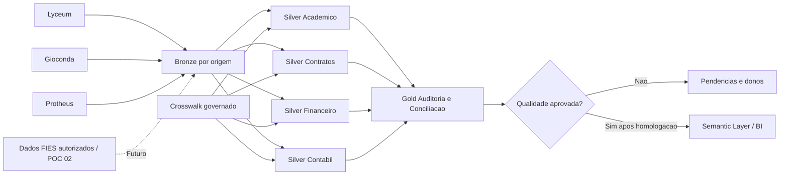

# FOURD / VITRU — POC 03: Financeiro governado no Databricks

  

> **PROVA DE CONCEITO EDUCACIONAL — SEM DADOS, ACESSOS OU VALIDACOES DE PRODUCAO.**
>
> Os nomes Lyceum, Gioconda, Protheus e FIES representam fronteiras de sistemas em uma hipótese de integração. Não inferimos tabelas ou APIs reais, privilégios ou funcionalidades do ambiente da Vitru.

## Pergunta de negocio

**Qual é a fonte ideal do financeiro do aluno?** O problema é a pulverização de eventos, contratos, cobrança, escrituração e relatórios em sistemas e planilhas diferentes. O objetivo **não é substituir todos os sistemas**, nem criar um cadastro financeiro paralelo no Databricks: é **recolocar as responsabilidades em seus domínios, padronizar integrações e publicar uma visão auditável de Contas a Receber**.

## Decisao proposta (hipotese a homologar)

1. **Fonte operacional continua com o dono:** acadêmico no Lyceum/Gioconda, evidência contratual no mecanismo autorizado, títulos operacionais nos respectivos legados e escrituração no ERP. A fonte oficial para cada campo depende de decisão formal do negócio/TI.
2. **Databricks organiza a leitura e a governança:** ingestão segura por fonte, Bronze, Silver por domínio, Gold **derivada** e não editável operacionalmente.
3. **O produto Gold só é liberado após reconciliação:** detecção de chaves ausentes, múltiplos títulos, alunos cancelados, aceite pendente e diferenças monetárias.
4. **Correções voltam ao sistema responsável por processo aprovado**, não via escrita automática do Databricks em sistemas reais.
5. **Uma visão única não significa uma tabela única.** Domínios independentes com produto final reconciliado.

## Arquitetura



## Dois modos de execução

### A. Simulador local — executável AGORA, sem bibliotecas extras

**PowerShell (Windows):**

```powershell
cd .\POC_03_DATABRICKS_GOVERNANCA
.\executar_demo.ps1
```

**Ou:**

```powershell
py -m poc3
py -m unittest discover -s tests -v
```

**Linux/Mac:** `./executar_demo.sh`.

Abra `saida_demo/RELATORIO_VISUAL.html` no navegador. Inspecione `saida_demo/RELATORIO_EXECUTIVO.md`, os CSVs de pendência e o arquivo `governanca/plano_realocacao.csv`.

### B. Spark + Delta + Unity Catalog — **referência de implantação, NÃO validada no workspace Vitru**

O script `databricks/execute_databricks.py` implementa transformações Spark DataFrame e tabelas Delta por domínio; o `databricks.yml` é um exemplo de Job declarativo. Exige permissões, cluster e um Volume com os CSVs fictícios. Veja `docs/GUIA_DATABRICKS.md` antes de tentar a execução.

> Não rode o Job contra produção. Ele usa **overwrite** intencionalmente apenas em um catálogo isolado com prefixo `vitru_poc_`. Em uma implementação real é obrigatório desenhar cargas incrementais, MERGE/CDC, retenção, identidade, evolução de esquema, agendamento e controles de rollback.

## Saida verificada da demo

| Indicador | Resultado demonstrativo |
|---|---:|
| Fontes de entrada | 8 |
| Registros em Bronze | 39 |
| Títulos operacionais | 7 |
| Títulos ERP | 8 |
| Títulos conciliados | 2 |
| Títulos com pendências | 5 |
| ERP sem contrapartida operacional | 1 |
| Valor operacional em análise | R$ 6.170,00 |
| Publicação para BI | **BLOQUEADA** por inconsistências propositais |

A Gold contém **7 linhas**, exatamente uma por título operacional; a duplicidade no ERP não gera duplicidade indevida na Gold.

## Estrutura do repositorio

```text
POC_03_DATABRICKS_GOVERNANCA/
├── poc3/                        # executavel local puro Python
├── databricks/                  # pipeline Spark + Delta por dominio
├── databricks.yml               # Job declarativo (exemplo parametrizado)
├── dados_ficticios/             # 8 arquivos CSV inventados para a demonstracao
│   ├── lyceum/
│   ├── gioconda/
│   ├── protheus/
│   └── governanca/
├── docs/                        # arquitetura, decisoes, TI, homologacao, LGPD
├── sql/                         # consultas Delta/SQL e orientacao CDC
├── resources/fontes.json        # inventario de fontes e estruturas esperadas
├── tests/                       # testes de controle, integridade e idempotencia
├── executar_demo.ps1
├── executar_demo.sh
└── saida_demo/                   # gerada em tempo de execucao, ignorada no Git
    ├── bronze/
    ├── silver/
    ├── gold/auditoria/
    ├── governanca/
    ├── RELATORIO_EXECUTIVO.md
    └── RELATORIO_VISUAL.html
```

## O que esta implementado e o que falta

**Implementado e testado localmente:** cópia íntegra de dados brutos e hashes, 5 domínios Silver, crosswalk de identidades, conciliação sem explosão de linhas, relatórios de exceções, reconciliação por marca/mês, matriz de realocação, linhagem declarativa, testes unitários e relatório visual.

**A validar com TI e negócio:** mapeamento de campos reais, fontes de verdade por atributo, eventos de alteração, qualidade/CDC das origens, modelo oficial de contratos e aceites, semântica dos títulos do Protheus, multiplicidades reais, FIES, infraestrutura Databricks, governança de acesso e definição formal do KPI.

**Fora de escopo desta demonstração:** alterar dados reais, criar aditivos jurídicos, obter FIES governamental diretamente, homologar contabilização, disponibilizar dashboard oficial e atualizar o ERP.

## Padrao tecnico reaproveitado

A estrutura segue o padrão de projetos anteriores de lakehouse: **ingestão → Bronze → Silver → Gold → Unity Catalog → Camada Semântica → BI**. A camada semântica só é servida depois de aprovado o contrato das medidas; IA/LLMs não definem valores financeiros oficiais por conta própria.

## Documentos para a revisao em conjunto

- [`docs/DIAGNOSTICO_E_DECISAO.md`](docs/DIAGNOSTICO_E_DECISAO.md) — manter separado, integrar ou realocar.
- [`docs/MATRIZ_DE_FONTE_DA_VERDADE.md`](docs/MATRIZ_DE_FONTE_DA_VERDADE.md) — quem é dono de cada dado.
- [`docs/CONTRATOS_DE_DADOS.md`](docs/CONTRATOS_DE_DADOS.md) — campos, chaves e regras de aceitação.
- [`docs/GUIA_DATABRICKS.md`](docs/GUIA_DATABRICKS.md) — como mover de local para sandbox Databricks.
- [`docs/HOMOLOGACAO_E_TI.md`](docs/HOMOLOGACAO_E_TI.md) — perguntas e critérios de aceite.
- [`docs/SEGURANCA_E_LGPD.md`](docs/SEGURANCA_E_LGPD.md) — segurança e mínimos privilégios.
- [`docs/INTEGRACAO_POC_01_02.md`](docs/INTEGRACAO_POC_01_02.md) — fronteiras entre os três projetos.
- [`docs/ROADMAP.md`](docs/ROADMAP.md) — backlog por etapas.
- [`docs/REFERENCIAS.md`](docs/REFERENCIAS.md) — documentação externa consultada.

## Licenca e observacoes

Protótipo técnico para discussão e homologação. Todos os nomes e identificadores de alunos são fictícios. Não contém código, conexões, segredos ou arquivos de empresa.
